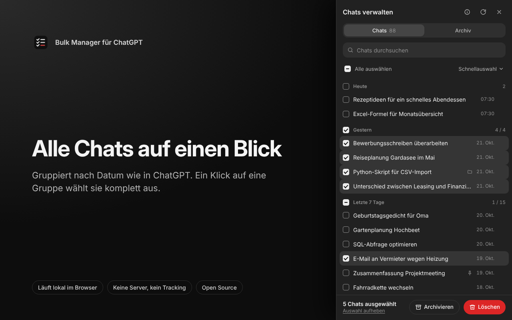

# Bulk Manager für ChatGPT

Chrome-Erweiterung, mit der du ChatGPT-Chats auf chatgpt.com durchsuchen, auswählen und gesammelt archivieren, wiederherstellen oder löschen kannst. Sie läuft lokal im Browser, ohne Konto, ohne Server und ohne Tracking.



## Funktionen

- Seitenpanel auf chatgpt.com mit allen Chats, gruppiert nach Datum (Heute, Gestern, letzte 7/30 Tage, Monate)
- Auswahl per Klick, Shift+Klick (Bereich), Klick auf die Gruppenüberschrift (ganze Gruppe) und Strg+A (alle sichtbaren)
- Live-Suche mit Hervorhebung
- Schnellauswahl: älter als 30/90/365 Tage, „alle außer die ältesten N“, Auswahl umkehren
- Angeheftete Chats werden bei Sammelauswahl übersprungen
- Archivieren mit Rückgängig, Archiv-Tab zum Wiederherstellen oder endgültigen Löschen
- Löschen mit Vorschau und Warnung bei ausgeblendeter Auswahl
- Fortschritt mit Restzeit, anhaltbar; automatische Drosselung bei Ratenlimits (HTTP 429)
- Fehlgeschlagene Chats bleiben markiert und ausgewählt
- Helles und dunkles Theme folgen ChatGPT automatisch

## Installation

**Chrome Web Store:** Der Link folgt nach der Freigabe.

**Entwicklerinstallation:**
1. Repository klonen oder als ZIP laden.
2. `chrome://extensions` öffnen und den Entwicklermodus einschalten.
3. „Entpackte Erweiterung laden“ wählen und den Ordner `extension/` angeben.

Öffnen kannst du das Panel über das Toolbar-Icon, mit `Alt+Shift+B` oder über die schmale Lasche am rechten Rand von chatgpt.com.

## Datenschutz

Siehe [Datenschutzerklärung](https://aemjay.github.io/bulk-manager-for-chatgpt/privacy.html). Kurz gesagt: Die Erweiterung kommuniziert ausschließlich mit chatgpt.com, liest keine Chat-Inhalte und speichert nur eine einzige Einstellung lokal.

## Aufbau

```
extension/   Quellcode der Erweiterung (Manifest V3, ohne Build-Schritt, ohne Abhängigkeiten)
docs/        GitHub Pages: Projektseite und Datenschutzerklärung
store/       Store-Grafiken und Eintragstexte (listing.md)
tests/       Mock von chatgpt.com, End-to-End-Tests, Generator für Store-Screenshots
scripts/     build-zip.sh erzeugt das Upload-Paket
```

## Entwicklung

```bash
npm install --prefix tests
npx --prefix tests playwright install chromium
npm test --prefix tests          # E2E-Tests (dunkel + hell) gegen einen nachgebauten chatgpt.com-Server
npm run shots --prefix tests     # Store-Screenshots und Promo-Kacheln neu erzeugen
```

Die Tests laden die echte Erweiterung in Chromium und leiten alle Anfragen an chatgpt.com auf einen Mock mit Fantasiedaten um. Ein echtes Konto wird nicht angesprochen.

## Release

1. Version in `extension/manifest.json` erhöhen.
2. Committen und mit `vX.Y.Z` taggen, dann pushen.
3. Der Workflow „Release“ baut `bulk-manager-for-chatgpt-X.Y.Z.zip` und hängt die Datei an ein GitHub-Release.
4. Die ZIP-Datei im [Developer Dashboard](https://chrome.google.com/webstore/devconsole) als neues Paket hochladen.

Lokal geht es auch: `scripts/build-zip.sh`.

## Sicherheit

- Listen, Auswahl und Schreibaufrufe sind an die Identität der ChatGPT-Sitzung gebunden (Nutzer + Konto). Vor jedem Lauf, regelmäßig währenddessen und nach jedem HTTP 401 wird die Sitzung frisch geprüft; bei einem Wechsel wird abgebrochen und alles verworfen.
- Zustandsänderungen und Schreibaufrufe reagieren nur auf echte Nutzerereignisse (`isTrusted`), nicht auf von Seitenskripten ausgelöste Klicks.
- Sammelauswahl fügt nie angeheftete Chats hinzu.
- Releases entstehen nur nach grünen E2E-Tests desselben Commits; Actions sind auf Commit-SHAs gepinnt, Testabhängigkeiten über `package-lock.json` fixiert.

Sicherheitsprobleme bitte an chrome@nspm.ovh melden.

## Hinweise

- Die Erweiterung nutzt die Web-Schnittstellen von chatgpt.com. Diese sind nicht offiziell dokumentiert und können sich ändern.
- Gelöschte Chats lassen sich nicht wiederherstellen.
- Kein Produkt von OpenAI. ChatGPT ist eine Marke von OpenAI.

## Lizenz

[MIT](LICENSE)
